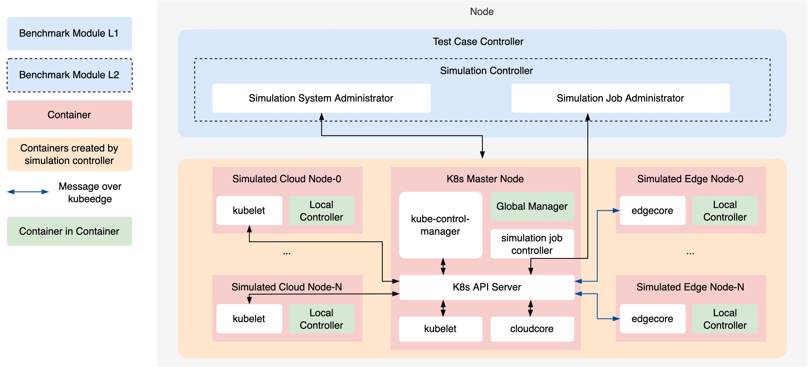

# How to build simulation env

This document introduces how to build a edge-cloud AI simulation environment(e.g. kubeedge sedna) with just one host.

## Introduction to `simulation controller`

The `simulation controller` is the core module of system simulation. The simulation controller has been supplemented, which build and deploy local edge-cloud simulation environment with K8s.



The models in `simulation controller` are as follows:

- The `Simulation System Administrator` is used to
  1. parse the system config(simulation)
  2. check the host enviroment, e.g. check if the host has installed docker, kind, and whether memory > 4GB
  3. build the simulation enviroment
  4. create and deploy the moudles needed in simulation enviroment
  5. close and delete the simulation enviroment
- The `Simulation Job Administrator` is the core module for manage the simulation job, and provides the following funcitons:
  1. build the docker images of algorithms to be tested
  2. generate the YAML file of `simulation job`
  3. deploy and delete the `simulation job` in K8s
  4. list-watch the results of `simulation job` in K8s

## Simulation System Administrator Experiment

At present, we have completed the construction of simulation environment through `Simulation System Administrator` module.

The detailed process is as follows:

### 1. Prepare the `benchmarkingJob.yaml` file

Typically, the config file `benchmarkingJob.yaml` is as follows, which represents the configuration information required for a benchmarkingJob.

```yaml
benchmarkingjob:
  # job name of benchmarking; string type;
  name: "benchmarkingjob"
  
  # the url address of job workspace that will reserve the output of tests; string type;
  # default value: "./workspace"
  workspace: "./workspace-mmlu"

  # the url address of test environment configuration file; string type;
  # the file format supports yaml/yml;
  testenv: "./examples/cloud-edge-collaborative-inference-for-llm/testenv/testenv.yaml"
  
  # the configuration of test object
  test_object:
    ...

  # the configuration of ranking leaderboard
  rank:
    ...
```

We need to supplement the config of simulation in the `benchmarkingJob.yaml`, such as the following.

```yaml
benchmarkingjob:
  ...

  simulation:
    cloud_number: 1
    edge_number: 2
    cluster_name: "ianvs-simulation"
    kubeedge_version: "v1.21.0"
    sedna_version: "v0.7.0"
```

Related parameters and explanations are as follows:

- `cloud_number` : int, number of the cloud worker (0-2).
- `edge_number` : int, number of the edge nodes (0-3).
- `cluster_name` : string, name of the simulation cluster; must not be empty if given.
- `kubeedge_version` : string, version of kubeedge; default v1.21.0. The Sedna all-in-one node image (`kubeedge/sedna-allinone-node:v1.30.0`, Kubernetes v1.30) bundles `keadm` v1.21.0, so another version needs a node image built for it; Ianvs warns when another version is set. `latest` is rejected, since the newest KubeEdge needs a newer node image.
- `sedna_version` : string, version of sedna; default v0.7.0, the newest Sedna release, tested with KubeEdge v1.21.0. `latest` lets the installer pick the newest release at build time.

Ianvs downloads the Sedna all-in-one installer from Sedna's `main` branch. To use another installer, for example of a Sedna pull request being tested, set the `SEDNA_INSTALL_URL` environment variable to its URL.

Invalid values (booleans, negative or out-of-range node counts, empty names, non-string versions) are rejected when the config is parsed. Unknown keys are ignored with a warning. The simulation environment is torn down automatically when the job ends, even if it fails.

The simulation requires a Linux host with Docker and kind installed. Ianvs no longer auto-installs them; it stops with a clear error if they are missing.

If building the environment fails, Ianvs removes the partially built cluster before reporting the error. If one test case fails, the results of the test cases that completed are still ranked; the job stops with an error only when every test case fails.

### 2. Run the benchmarkingJob

We just need to attach the `benchmarkingJob.yaml` when executing the `ianvs` command as before. Just like `ianvs -f /somepath/benchmarkingJob.yaml`

Next, the `Simulation System Administrator` module will first check your system environment, including the following checks:

1. Whether `docker` is installed and its daemon is reachable. If not, Ianvs stops with an error that links to the Docker installation guide.
2. Whether `kind` is installed and `kind version` runs. If not, Ianvs stops with an error that links to the kind quick start.
3. Whether at least 4 GB of memory is available. Ianvs reads `MemAvailable` from `/proc/meminfo` (falling back to `MemFree`), and inside a container it also applies the container's memory limit (cgroup).
4. Whether at least 4 CPU cores are available. Ianvs counts the cores it is allowed to use, and inside a container it also applies the container's CPU limit (cgroup), so the check reflects what the simulation can really use.

If you pass the above environment tests, you will see output like the following in the terminal (adapted from the original 2022 run, in the current check order; your timestamps and line numbers will differ).

```shell
[2022-10-29 01:12:54,544] simulation_system_admin.py(48) [INFO] - check docker successful
[2022-10-29 01:12:54,559] simulation_system_admin.py(61) [INFO] - check Kind successful
[2022-10-29 01:12:54,617] simulation_system_admin.py(99) [INFO] - check memory successful
[2022-10-29 01:12:54,626] simulation_system_admin.py(130) [INFO] - check cpu successful
```

Next, the module starts installing all-in-one environment of sedna. If all goes well, you should get the following output:

```shell
NAME                  READY   STATUS    RESTARTS   AGE
gm-5bb9c898d6-45fnv   1/1     Running   0          33s
kb-6b7897c89-ljxbb    1/1     Running   0          34s
lc-9tkdj              1/1     Running   0          33s
lc-cc5gl              1/1     Running   0          33s
lc-qnhfp              1/1     Running   0          33s
lc-tmx62              1/1     Running   0          33s
Sedna is running:
See GM status: kubectl -n sedna get deploy
See LC status: kubectl -n sedna get ds lc
See Pod status: kubectl -n sedna get pod
[I1029 01:16:56.974] Mini Sedna is created successfully
[2022-10-29 01:17:12,880] simulation_system_admin.py(170) [INFO] - Congratulation! The simulation enviroment build successful!
```

In the end. You get an all-in-one environment of sedna.

## Running the test cases in the simulation cluster

By default the test cases still run on the host. Add a `sandbox_profile` to run each test case as a Kubernetes Job in the simulation cluster instead, with the memory and CPU limits of an edge device:

```yaml
benchmarkingjob:
  ...
  simulation:
    cloud_number: 1
    edge_number: 1
    cluster_name: "ianvs-sandbox"

  sandbox_profile:
    enabled: true
    # optional, all keys below
    image: ""                          # a prebuilt image; empty builds one
    base_image: "python:3.9-slim"      # base of the built image
    requirements: ["./examples/my-example/requirements.txt"]   # requirement files or local .whl files
    data_paths: ["./dataset/extra"]    # paths the algorithm reads besides those in its configs
    timeout: 3600                      # seconds per test case
    system_metrics: "all"              # or a list, e.g. ["peak_memory_mb", "wall_time_s"]

  # optional; overrides the defaults field by field
  device_simulation:
    max_memory_mb: 2048
    max_cpu_cores: 2
    network_bandwidth_mbps: 50         # default 100
    network_latency_ms: 20             # added round-trip delay; default 0
```

A `sandbox_profile` needs a `simulation` block, and `device_simulation` needs a `sandbox_profile`. Invalid values are rejected when the config is parsed.

How a test case runs:

1. Before the first test case, the `Simulation Job Administrator` builds the image from the Ianvs `core`, `requirements.txt`, the wheels in `resources/third_party` and the `requirements` entries (requirement files or local `.whl` files). A local wheel is installed without the dependencies it declares, as examples install their algorithm wheels on the host; list what it needs in a requirements file. The image is tagged by the digest of those files, so an unchanged image is not rebuilt. The image is imported straight into the node's containerd, so no registry is needed.
2. The test cases run on an edge node if the cluster has one, else on a cloud worker, else on the control plane.
3. The files a test case reads (its test environment and algorithm configs, the paths they reference, and `data_paths`) are copied onto the node and mounted at the same absolute paths. They are copied once per run and shared by the test cases, so a large dataset is not copied again for each test case. The Job runs from the host's working directory, so relative paths in the configs resolve as they do on the host.
4. The Job's memory and CPU limits come from `device_simulation`, or else from the paradigm's defaults:

   | Paradigm | Memory (MiB) | CPU cores |
   |---|---|---|
   | singletasklearning | 1024 | 1 |
   | incrementallearning | 1536 | 2 |
   | lifelonglearning | 3072 | 2 |
   | federatedlearning | 2048 | 4 |
   | federatedclassincrementallearning | 2560 | 4 |
   | jointinference | 4096 | 2 |
   | multiedgeinference | 2048 | 2 |

   Swap is turned off for the node's pods, so a test case over its memory limit is OOM-killed instead of swapping.
5. The Job's network is shaped with `tc`/`netem` before the test case starts: `network_bandwidth_mbps` in both directions, and `network_latency_ms` added to every round trip. The defaults are 100 Mbit/s and 0 ms.
6. While the Job runs, the `System Metrics Profiler` samples the pod's cgroup on its node (memory, CPU, disk I/O), its network traffic and the size of its output directory. Nothing runs inside the test case.
7. The pod reports its metrics in its termination message, which the node reports to the API server. Pods on KubeEdge edge nodes cannot reach the API server themselves, so they cannot write the result to a ConfigMap. The test case's output directory is copied back to the host workspace, together with `sandbox_result.json` and the pod's log, `sandbox.log`.

A test case that fails in the sandbox fails alone, as on the host. It is reported as `OOM_FAILURE` (it exceeded its memory limit), `EXEC_FAILURE` (it raised an error, with the error in the log) or `TIMEOUT`, and it is still ranked: the leaderboard has a `status` column, and a failed test case has a row with its status and the system metrics measured before it failed. A failed test case also keeps what it wrote before it failed, its `sandbox.log`, and a `sandbox_result.json` with its status, error and system metrics.

### System metrics

The system metrics of each test case are merged into its results, after the test environment's own metrics. `all_rank.csv` has all of them; list the ones you want in `selected_rank.csv` under `rank.selected_dataitem.metrics`, as with any other metric. Do not list them under the test environment's `metrics`.

| Metric | Meaning | Unit |
|---|---|---|
| `wall_time_s` | how long the test case ran | seconds |
| `cpu_utilization_avg` / `cpu_utilization_max` | how busy its CPU quota was, on average and in the busiest sampling interval | fraction 0–1 of `max_cpu_cores` |
| `cpu_cores_used_avg` | the average number of cores in use | cores |
| `peak_memory_mb` | the most memory it used at any moment (the kernel's `memory.peak`) | MB |
| `memory_utilization_avg` | its average memory, as a share of `max_memory_mb` | fraction 0–1 |
| `oom_failure` | whether it was killed for exceeding its memory limit | true / false |
| `disk_read_bytes` / `disk_write_bytes` | data read from and written to disk (page-cache hits are not counted) | bytes |
| `disk_read_mb_s_avg` / `disk_write_mb_s_avg` | average disk read and write speed | MB/s |
| `disk_usage_peak_mb` | the largest size its output directory reached | MB |
| `model_artifact_size_mb` | the size of the model files it saved | MB |
| `network_bandwidth_mbps_avg` / `network_bandwidth_mbps_peak` | traffic into and out of its pod, on average and in the busiest sampling interval | Mbit/s |
| `network_latency_ms` / `network_profile` | the emulated delay, and a label of the network condition, e.g. `50mbps-20ms` | ms / text |
| `gpu_*` | GPU utilization, memory, power and energy | `N/A`: the simulation cluster has no GPUs |

MB means 2^20 bytes. Samples are taken every 2 seconds, so the averages of a test case that runs only a few seconds rest on few samples; `peak_memory_mb` comes from the kernel and misses no spike.

## Troubleshooting

| Message or symptom | Cause | What to do |
|---|---|---|
| `docker is not installed; install it from https://docs.docker.com/get-docker/` | Docker is not on the host. | Install Docker, then run Ianvs again. |
| `docker is installed but the daemon is not reachable; is it running?` | The Docker daemon is stopped, or your user cannot access it. | Start the daemon (for example `sudo systemctl start docker`) and make sure your user may run `docker version`. |
| `kind is not installed; install it from https://kind.sigs.k8s.io/docs/user/quick-start/` | kind is not on the host. | Install kind, then run Ianvs again. |
| `failed to download the installer from ...` | The Sedna all-in-one installer could not be downloaded. | Check the host's network access to `raw.githubusercontent.com`; building the environment needs a network connection. |
| `cannot read host memory info (simulation requires a Linux host)` | Ianvs is not running on Linux. | Run the simulation on a Linux host. |
| `The current free memory is insufficient ...` or `The number of cpus is insufficient ...` | The host, or the container Ianvs runs in, has less than 4 GB of available memory or fewer than 4 CPU cores. | Free memory, raise the container's limits, or use a larger host. The message shows the current and required values. |
| The build fails while pulling `kubeedge/sedna-allinone-node:v1.30.0` | The node image is not available from Docker Hub. | Build it locally with Sedna's `scripts/installation/build-allinone-image.sh` (about 2 minutes), then run Ianvs again. |
| The edge nodes fail to join with a `kubeedge_version` other than v1.21.0 | The node image's `keadm` is built for KubeEdge v1.21.0. | Use the default `v1.21.0`, or a node image built for your version. |
| A test case fails with `OOM_FAILURE` | It needed more memory than its limit in the sandbox. | Raise `device_simulation` `max_memory_mb`, or reduce what the test case loads. |
| A test case fails with `EXEC_FAILURE` and `No module named ...` | A package the algorithm needs is not in the sandbox image. | List the example's requirements file, or its local wheel, in `sandbox_profile` `requirements`. |
| A test case fails with `EXEC_FAILURE` and a missing file | The algorithm reads a path that none of its configs reference. | Add the path to `sandbox_profile` `data_paths`. |
| A test case fails with `TIMEOUT` | It ran longer than `sandbox_profile` `timeout`. | Raise `timeout`. |
| `EXEC_FAILURE: network emulation could not be applied: ...` | `tc` could not shape the pod's network on its node. | Check that the node image has `tc` (iproute2) and that the node container is privileged, as the Sedna all-in-one nodes are. |
| `sandbox_profile system_metrics: unknown metrics [...]` | A name in `system_metrics` is not a system metric. | Use `"all"` or names from the System metrics table. |
