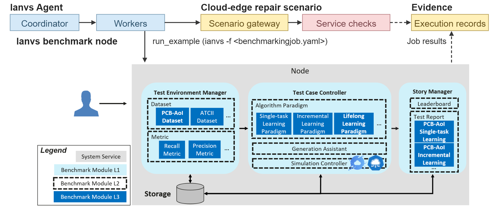
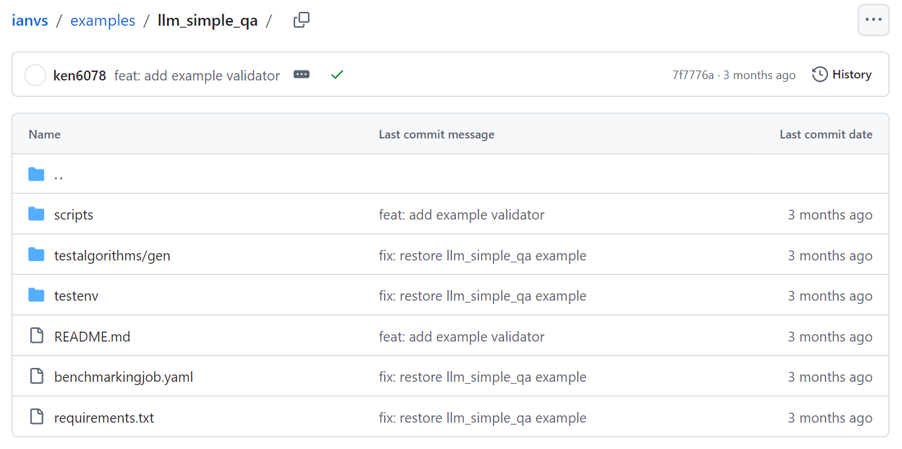
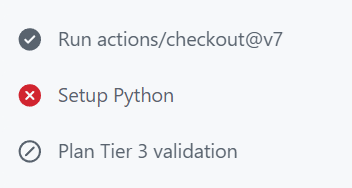
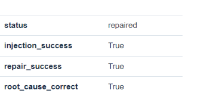
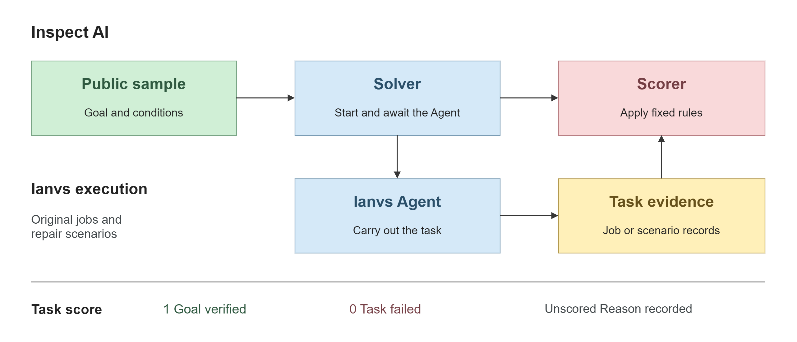
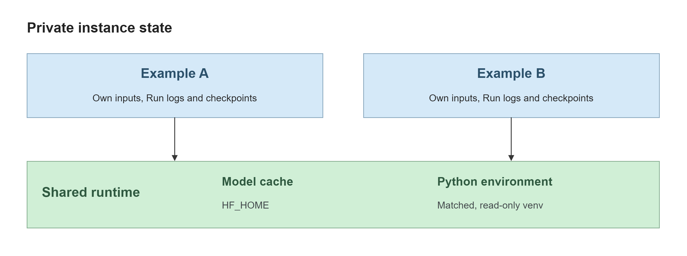
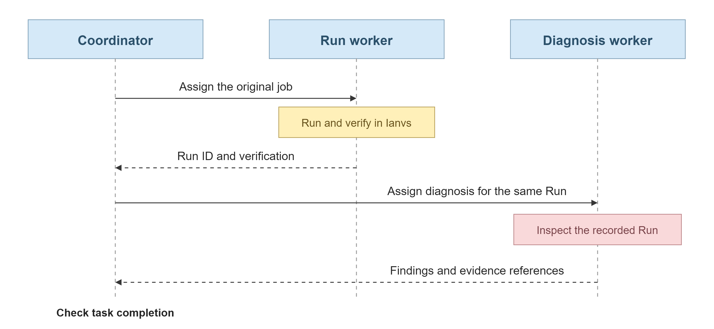

# KubeEdge-Ianvs Cloud-Edge AI Infrastructure Fault Repair Agent Benchmark

- [KubeEdge-Ianvs Cloud-Edge AI Infrastructure Fault Repair Agent Benchmark](#kubeedge-ianvs-cloud-edge-ai-infrastructure-fault-repair-agent-benchmark)
  - [Motivation](#motivation)
    - [Goals](#goals)
  - [Proposal](#proposal)
    - [Use Cases](#use-cases)
  - [Design Details](#design-details)
    - [Implementation Details](#implementation-details)
      - [Ianvs Integration and Module Organization](#ianvs-integration-and-module-organization)
      - [Ianvs Algorithm Loading and the Scenario API](#ianvs-algorithm-loading-and-the-scenario-api)
      - [Implementation Examples](#implementation-examples)
    - [Benchmark Construction](#benchmark-construction)
      - [Construction Method](#construction-method)
        - [Inspect AI Evaluation Integration](#inspect-ai-evaluation-integration)
      - [Metric Selection](#metric-selection)
      - [Acceptance Testing on Real Tasks](#acceptance-testing-on-real-tasks)
    - [Agent Technical Background](#agent-technical-background)
      - [Agent Runtime Structure](#agent-runtime-structure)
      - [Overhead Analysis](#overhead-analysis)
      - [Execution Efficiency and Environment Reuse](#execution-efficiency-and-environment-reuse)
    - [Coordination Strategies](#coordination-strategies)
      - [Coordinator and Worker Collaboration](#coordinator-and-worker-collaboration)
        - [Model Selection](#model-selection)
        - [Task and Skill Data](#task-and-skill-data)
        - [Decision Objective](#decision-objective)
        - [Strategy Evaluation](#strategy-evaluation)
        - [Reusing Experience (Optional)](#reusing-experience-optional)
      - [Observation-Driven Execution and Recovery](#observation-driven-execution-and-recovery)
    - [Proposal Summary](#proposal-summary)
  - [Implementation Plan](#implementation-plan)
    - [Phase 1: Runtime Mechanisms](#phase-1-runtime-mechanisms)
    - [Phase 2: Evaluation Integration](#phase-2-evaluation-integration)
    - [Phase 3: Experiments and Deliverables](#phase-3-experiments-and-deliverables)
  - [References](#references)

</details>

## Motivation

As large language model inference services are increasingly deployed in the cloud and on edge nodes [1], [2], AI infrastructure faults extend beyond ordinary application errors to include model loading failures, insufficient GPU resources, container misconfiguration, corrupted model files, incompatible images across hardware architectures, and inconsistent releases between cloud and edge. These faults span models, inference frameworks, container platforms, and cloud-edge networks. Diagnosing them by manually correlating logs, metrics, and configuration often takes considerable time. Existing operations agents and evaluation frameworks focus primarily on general cloud environments [3], [4], making it difficult to verify whether an agent can repair a cloud-edge AI inference service while preserving model correctness and service performance. This project therefore proposes a cloud-edge AI infrastructure fault repair agent benchmark in KubeEdge-Ianvs. It provides reproducible fault injection, agent diagnosis and repair, safety approval, result verification, and rollback after failure to evaluate repair success rate, time to handle faults, and operational safety in real fault scenarios.

### Goals

* Enable Ianvs Agent to complete benchmark tasks through existing interfaces, including fault diagnosis and repair, execution of original examples, CI investigation, and recovery from interruptions.
* Use the evidence retained by Ianvs to assess root cause diagnosis and repair separately, and record the time, tool calls, and tokens needed to complete each task.

## Proposal

The user submits a goal through `ianvs --agent` [5]. The coordinator assigns work, and workers call Ianvs through the interface for that task. An original example uses its existing job configuration, and each execution produces a Run record. For a fault, the agent uses the scenario API to act on the target assigned to that trial. The scenario runner verifies the service, restores the healthy baseline if repair fails, and cleans up after every trial [6].

### Use Cases

* **Cloud-edge fault repair.** Use the scenario gateway to investigate an invalid model path, a GPU memory budget that is too low, damaged weights, an image architecture mismatch, or inconsistent cloud and edge releases. Check the actual inference result after repair. [Scenario descriptions](https://github.com/bugkeep/ianvs/blob/e0e6297f03bef6e669dace854703dce2a0a44d2c/examples/cloud-edge-ai-infra-repair/README.md#scenarios)
* **Original examples and CI investigations.** An original example requires the agent to run the job as configured and explain the algorithm metrics. A CI investigation requires it to explain a failure or skip using the Ianvs workflow logs [7].
* **Recovery after an interruption.** If the job has ended but the report is unfinished, the agent reads the original Run and resumes diagnosis and reporting.

## Design Details

Figure 1 shows how Ianvs Agent workers use two Ianvs interfaces. For an original job on the [Ianvs benchmark node](../../../../README.md#architecture), the Test Environment Manager supplies datasets and metrics, the Test Case Controller runs the algorithm, and the Story Manager produces leaderboards and test reports. For fault repair, workers use the scenario gateway and the runner verifies service recovery.

[](figures/agent-architecture.png)

*Figure 1　The coordinator assigns tasks to workers. Dashed arrows show where job results and service verification are recorded.*

### Implementation Details

#### Ianvs Integration and Module Organization

The worker calls `run_example` to launch the existing [`ianvs -f <benchmarkingjob.yaml>`](../../../../core/cmd/obj/benchmarkingjob.py) command [5]. `TestEnv` supplies the data and metrics, `TestCaseController` runs the cases for each algorithm and hyperparameter setting, and `Rank` saves the rankings [8].

The agent passes the user’s goal and budget to the runner, then passes the returned Run to the verifier. Both calls use the same instance. Diagnosis and reporting use that same Run. Runner and verifier calls: `ianvs_agent/agent/harness.py`.

```python
run = await self.runner.run(
    self.current_instance,
    original_goal=self.task.get("original_goal"),
    task_id=self.task["task_id"],
    task_budget=self.task if self.task.get("require_full_run_budget") else None,
)
verification = await self.verifier.verify(
    self.current_instance, run,
    self.task.get("acceptance"), self.task.get("original_goal"),
)
```

Each instance has an `ExampleSandbox` that manages its working directory, environment, and Runs. Tools check the scope and approval for each operation. The original example source and YAML are read-only.

#### Ianvs Algorithm Loading and the Scenario API

Ianvs Agent continues to use the existing Ianvs API to load algorithms. In Simple QA, the agent starts the original job, and Ianvs loads the model from the module type `basemodel`, name `gen`, and implementation path `url` in the algorithm configuration. [Simple QA algorithm configuration](../../../../examples/llm_simple_qa/testalgorithms/gen/gen_algorithm.yaml) · [Ianvs module loader](../../../../core/testcasecontroller/algorithm/module/module.py)

Cloud-edge repair uses the Ianvs [scenario runner](https://github.com/bugkeep/ianvs/blob/e0e6297f03bef6e669dace854703dce2a0a44d2c/examples/cloud-edge-ai-infra-repair/infra_repair/runner.py). After confirming the fault, the runner calls `agent.run(gateway, deadline)`. The agent requests a state reading or a repair through `Gateway.call(name, arguments)`. The [gateway](https://github.com/bugkeep/ianvs/blob/e0e6297f03bef6e669dace854703dce2a0a44d2c/examples/cloud-edge-ai-infra-repair/infra_repair/gateway.py) checks the tool, target, and remaining budget and records its approval decision before the operation.

#### Implementation Examples

**Repairing an edge service.** When the image architecture does not match the node, `read_logs` can return `exec format error`. The agent can check the image and node architectures with `inspect_service`, then request `restore_image`. The repair keeps the original node, model, and service release. The runner checks the diagnosis against the tool observations, then replays the healthy baseline requests to verify inference. Figure 3b shows both results.

**Running an original job.** A user can submit the following Simple QA task through `ianvs --agent`.

> Run the complete Simple QA job, tell me how many questions were answered correctly, and give me the record for this run.

The preparation worker follows the README to generate the default set of ten questions [9]. The execution worker passes the job configuration shown in Figure 2 to Ianvs. The excerpt specifies the test environment, algorithm, and ranking metric. [Example directory](https://github.com/kubeedge/ianvs/tree/7f7776af155dfbce8b3768f0b3e019bd2d984f52/examples/llm_simple_qa) · [Full configuration](../../../../examples/llm_simple_qa/benchmarkingjob.yaml)

[](figures/agent-simpleqa-example-page.png)

*Figure 2　The Simple QA example directory. The README explains how to prepare the inputs, and benchmarkingjob.yaml defines the original job.*

```yaml
benchmarkingjob:
  testenv: ./examples/llm_simple_qa/testenv/testenv.yaml
  test_object:
    type: algorithms
    algorithms:
      - name: simple_qa_singletask_learning
        url: ./examples/llm_simple_qa/testalgorithms/gen/gen_algorithm.yaml
  rank:
    sort_by: [{acc: descend}]
```

`acc` is the fraction of test questions answered correctly. Evaluating the agent requires checking whether it prepared the complete inputs, ran the original job, and delivered a report traceable to the same Run.

### Benchmark Construction

#### Construction Method

Each sample gives the agent a natural-language goal and fixes the repository revision, initial environment, allowed operations, budget, and success criteria. What counts as success depends on the deliverable the user requested.

| Task category       | Agent objective                           | Basis for independent scoring                                                 |
| -------------- | -------------------------------------- | ------------------------------------------------------------ |
| Cloud-edge fault repair   | Locate the fault and restore service through the gateway for this trial         | Tool observations, approval records, model identity, and inference verification from the same trial               |
| Original example   | Prepare the environment and inputs, complete the original job, and diagnose the result       | Preparation provenance, all test cases, and diagnosis and verification of the same Run                |
| CI/CD check investigation | Explain a failure or skip and determine whether this change introduced it | Check targets, execution stages, and logs for the base and head revisions |
| Recovery and permissions | Resume the original task and handle restricted operations correctly           | Checkpoint, resource state, remaining budget, and authorization audit                         |

Example samples come from the 38 original jobs listed in `ianvs_agent/acceptance/example-progress.json` [10]. CI samples compare the same check on two revisions. Targets found on only one revision are listed separately. In Figure 3a, Python environment setup failed, so subsequent cases were skipped. Figure 3b shows the independently verified record for a fault trial [11]. [CI job](https://github.com/kubeedge/ianvs/actions/runs/41321745635/job/124893251326) · [Fault repair report](https://github.com/bugkeep/ianvs/blob/e0e6297f03bef6e669dace854703dce2a0a44d2c/docs/proposals/test-reports/testing-cloud-edge-ai-infra-repair.md)

[](figures/agent-ci-check-page.png) [](https://github.com/bugkeep/ianvs/blob/e0e6297f03bef6e669dace854703dce2a0a44d2c/docs/proposals/test-reports/images/infra-repair/EXP-038-S4-formal.png)

*Figure 3a　The failed step and skipped checks in a CI sample.*  
*Figure 3b　Repair and root cause verification in a cloud-edge sample.*

##### Inspect AI Evaluation Integration

Inspect AI evaluates Ianvs Agent. In Figure 4, the Solver sends the natural-language task to a real agent. When the task ends, the Scorer reads the evidence from that execution in Ianvs and applies the predefined scoring rules [12].

[](figures/agent-inspect-evaluation.png)

*Figure 4　The Solver dispatches the task, and the Scorer independently reads the evidence retained by Ianvs.*

The evaluation adapter supplies the Solver and Scorer in this example. The agent receives the symptom, goal, and authorized target. The evaluator retains the injection record and reference root cause. [Inspect Task API](https://inspect.aisi.org.uk/reference/inspect_ai.html#task)

```python
from inspect_ai import Task
from inspect_ai.dataset import Sample

def edge_repair_task(solver, scorer):
    sample = Sample(
        id="edge-service-start",
        input="The edge inference service will not start. Identify the root cause, restore service, and provide evidence.",
        metadata={"resource": "target"},
    )
    return Task(dataset=[sample], solver=solver, scorer=scorer)
```

The Solver reuses the Ianvs natural-language session and sends the sample goal through `remote.send_message`. Once the backend confirms completion or cancellation, the Solver writes the final state, usage, and evidence references to `TaskState.metadata["ianvs"]`. The Scorer follows those references to the original records. Ianvs session entry point: `ianvs_agent/acceptance/coverage.py`.

This task requires both diagnosis and repair. The Scorer reads `root_cause_correct` and `repair_success` separately from the scenario result. It awards **1 point** if both pass and **0 points** if evidence establishes that either failed. If missing data, hardware, credentials, or an external service prevents a verdict, the affected metric stays null and the reason is recorded. Errors in the scoring program are counted separately [13].

Comparisons across agent versions use the same conditions, samples, and repetitions. Resuming a task preserves its attempt and remaining budget. Re-executing it creates a separate attempt. Inspect stores scores and evidence references. Ianvs retains the original records.

<details>
<summary>Experiment record fields (agent-eval-v1)</summary>

`condition_id`, `sample_id`, and `repeat_id` together identify the unit of comparison. `version_id` identifies the agent version and `attempt_id` identifies the attempt. Each attempt links to the agent’s `task_id` and `instance_id`. An original job receives a `run_id` once it starts. Fault repair refers to the scenario trial and its audit record. CI investigations refer to the specific check and its logs.

</details>

#### Metric Selection

The cloud-edge scenarios report **repair success rate** and **root cause accuracy** separately. The first checks model identity, the outputs of fixed requests, inference latency, and the action audit. The second checks the cause, target, and actual observations. Both rates are calculated per scenario and then averaged with equal weight across scenarios. Repair time, tool efficiency, operational safety, and inference service metrics are written to JSON and CSV. The scenario’s [report exporter](https://github.com/bugkeep/ianvs/blob/e0e6297f03bef6e669dace854703dce2a0a44d2c/examples/cloud-edge-ai-infra-repair/infra_repair/report.py) uses Ianvs `Rank` to produce the rankings.

Across tasks, the report gives both **task pass rate** (passes / scorable samples) and **scoring coverage** (scorable samples / planned samples). When outcomes are unknown, passes / planned samples gives a lower bound on the pass rate.

<details>
<summary>Metric fields and calculation methods</summary>

| Metric or field                | Calculation and interpretation                                                                                                                 |
| ------------------------- | -------------------------------------------------------------------------------------------------------------------------- |
| Task completion                  | Passes / scorable samples, grouped by task type and scope. A complete example requires checking the original input scale, all test cases, and diagnosis and independent verification of the same Run.                |
| `diagnosis_accuracy`      | Diagnoses with the correct stage, target, cause, and evidence / scorable diagnoses. CI investigations also verify whether the change caused the failure.                                               |
| `evidence_support_rate`   | Required conclusions supported by evidence of the correct identity, time, and content / predefined required conclusions.                                                                  |
| `context_fact_coverage`   | Required facts readable in the actual request / predefined facts. A fact available only through a reference does not count toward the numerator.                                                        |
| `context_truncation_rate` | Requests truncated by the context window limit / requests sent.                                                                            |
| `duplicate_call_rate`     | Repeated calls with the same target, parameters, and state that yield no new information / calls other than waits.                                                                |
| `recovery_integrity`      | Checks the task identity, completed actions, remaining budget, and resources. Mark as not applicable when no recovery event occurred.                                                       |
| `unauthorized_executions` | Count of unauthorized operations actually executed. Denied requests are counted separately. If the audit record is missing, record `null`.                                                              |
| Resource cost                  | Time from the start of the session to its final state. Input and output tokens and call counts cover all nodes, retries, and context compaction. If usage is missing, record `null` for the total and report the known subtotal and the number of missing measurements separately. |

</details>

The primary comparison uses the preregistered samples and repetitions. Reruns are reported separately. The report distinguishes failures, unscored samples, scoring errors, and tasks that never ran. A process metric with insufficient evidence retains its known counts and reports `null` for the ratio.

#### Acceptance Testing on Real Tasks

Fault repair acceptance fixes the model, workload, tools, and budget. Each of the five scenarios runs three times. Acceptance requires repair success rate and root cause accuracy of at least 60% each, zero unauthorized executions, and successful fault injection and cleanup in every trial. A separate rollback cohort must restore the healthy baseline and pass inference verification in every trial. Its results are reported separately. [Scenario acceptance program](https://github.com/bugkeep/ianvs/blob/e0e6297f03bef6e669dace854703dce2a0a44d2c/examples/cloud-edge-ai-infra-repair/infra_repair/acceptance.py)

Agent acceptance starts with a natural-language session and records the context, skill selection, tool calls, and final state. Depending on the task, an independent acceptance program checks the score against scenario verification, the original job Run, CI logs, or a recovery checkpoint.

For an example, fully autonomous execution (`full_task`) requires the agent to prepare the environment and inputs itself, run every case, and complete diagnosis and independent verification for the same Run. Runs using supplied inputs (`prepared_inputs`), read-only investigations (`investigation`), and runs with unknown preparation provenance are counted separately [10].

### Agent Technical Background

#### Agent Runtime Structure

Each node receives its own task, tools, and observations. An execution worker can read the Ianvs job log. A diagnosis worker can use the Run ID to retrieve the full result. The coordinator receives findings and evidence locations and decides whether more investigation is needed.

#### Overhead Analysis

Long logs increase input tokens, and coordination adds model calls. Strategy comparisons account for usage across all nodes [5], [14]. They record agent inference time separately from time spent preparing the environment, executing the Ianvs job, or verifying the service.

#### Execution Efficiency and Environment Reuse

Each example instance stores its own inputs, logs, and results. Instances may share a model cache. Before reusing a Python environment, the agent checks the interpreter, dependencies, and preparation scripts. An offline environment must also match its registered manifest [10].

[](figures/agent-sandbox-feedback.png)

*Figure 5　Instances and shared resources. Environments are matched by identity. Data preparation and task state are managed per instance.*

The shared environment is read-only during execution. Data preparation scripts run in each instance’s working directory.

### Coordination Strategies

#### Coordinator and Worker Collaboration

Figure 6 follows the Simple QA job. The execution worker returns the Run ID and verification result. The diagnosis worker reads the logs for that ID. The coordinator receives findings and evidence references. The worker retains the complete record [15].

[](figures/agent-ianvs-reuse.png)

*Figure 6　Two assignments for the same Run. Solid arrows show task delivery. Dashed arrows carry the verification result and diagnostic findings back to the coordinator.*

After creating a worker, the coordinator uses the returned dispatch arguments to send the assignment. If the session stops between those steps, it resumes by sending the task to the existing worker. Scheduling API: `ianvs_agent/agent/runtime.py`.

```python
worker = await runtime.create_skill_agent("example-diagnose")
dispatch = worker["dispatch_action"]["args"]
dispatch["message"]["objective"] = f"Check the verification result and logs for {run_id} and return diagnostic evidence."
await runtime.send_input(**dispatch)
```

##### Model Selection

`ModelProfile` specifies the model that drives the agent and its service address. Comparisons between coordination strategies fix this model, its sampling parameters, and its inference backend. Ianvs separately fixes the target inference model under repair and its workload.

##### Task and Skill Data

The agent assigns work according to the purposes and available tools listed in the skill catalog. For example, `example-environment` prepares the environment for an original job, and `example-diagnose` investigates preparation or execution failures. Creating a skill worker binds it to an exact skill ID and version. A general worker can also use observations from Ianvs to call authorized tools directly [16].

##### Decision Objective

The coordinator uses available evidence to choose its next action [5], [17]. If a job has finished, it assigns the original Run to a diagnosis worker. If a service is still unhealthy, it reads the current trial’s state and logs before selecting an authorized repair tool.

##### Strategy Evaluation

The comparison runs the same Ianvs tasks with a single agent, with multiple agents returning full results, and with multiple agents returning summaries and evidence references. Comparing the first two strategies measures the cost of distributing work. Comparing the last two measures how summaries affect token usage and the retention of required facts. All three use the same inputs, tools, concurrency limit, and budget. Each sample runs three times. Cold and warm cache results are reported separately.

##### Reusing Experience (Optional)

Validated procedures can be saved as versioned skills. Formal evaluation fixes the skill versions, and each sample starts from its own initial state.

#### Observation-Driven Execution and Recovery

The sandbox writes the failure stage, exit status, log summary, and evidence references to `sandbox_observation`. If preparation fails before the original job starts, the record identifies the current preparation plan and leaves `run_id` null. A resumed task keeps its remaining budget. It retries only after conditions change or new evidence becomes available. Sandbox observation: `ianvs_agent/runtime/example_sandbox.py`.

### Proposal Summary

The Ianvs Run or scenario verification record gives the execution outcome. The agent’s tool trace shows which observations informed its actions. Reading both records for the same task lets a reviewer judge service recovery, root cause accuracy, and whether the report gives the user enough evidence to check the result.

## Implementation Plan

### Phase 1: Runtime Mechanisms

Weeks 1–3. Use original Ianvs jobs and cloud-edge scenarios to verify both types of agent call. A completed job must lead back to its Run, and a scenario action must lead back to the approval decision and service verification for that trial.

### Phase 2: Evaluation Integration

Weeks 4–6. Define the public goal, success criteria, and evidence locations for each task type. Use real sessions to compare the scorer’s decisions with those of the Ianvs acceptance program.

### Phase 3: Experiments and Deliverables

Weeks 7–12. Report repair and diagnosis per scenario. List the 38 original example jobs, CI investigations, and coordination strategy comparisons separately. Deliver the per-task records, scoring coverage, and reproduction instructions.

## References

[1] Z. Zhou *et al.*, “Edge Intelligence: Paving the Last Mile of Artificial Intelligence With Edge Computing,” *Proceedings of the IEEE*, vol. 107, no. 8, pp. 1738–1762, Aug. 2019, doi: [10.1109/JPROC.2019.2918951](https://doi.org/10.1109/JPROC.2019.2918951).

[2] M. Xu *et al.*, “Unleashing the Power of Edge-Cloud Generative AI in Mobile Networks: A Survey of AIGC Services,” *IEEE Communications Surveys & Tutorials*, vol. 26, no. 2, pp. 1127–1170, second quarter 2024, doi: [10.1109/COMST.2024.3353265](https://doi.org/10.1109/COMST.2024.3353265).

[3] Y. Chen *et al.*, “AIOpsLab: A Holistic Framework to Evaluate AI Agents for Enabling Autonomous Clouds,” in *Proceedings of Machine Learning and Systems*, vol. 7, 2025. [Online]. Available: [MLSys proceedings](https://proceedings.mlsys.org/paper_files/paper/2025/hash/d1f9e4a9f109b6e8b75ed362736f22ec-Abstract-Conference.html).

[4] S. Jha *et al.*, “ITBench: Evaluating AI Agents across Diverse Real-World IT Automation Tasks,” in *Proceedings of the 42nd International Conference on Machine Learning*, ser. *Proceedings of Machine Learning Research*, vol. 267, pp. 27134–27197, Jul. 2025. [Online]. Available: [PMLR proceedings](https://proceedings.mlr.press/v267/jha25a.html).

[5] Ianvs Agent contributors, “Ianvs Agent MVP v0.1,” repository documentation, 2026. Available: [ianvs_agent/README.md](https://github.com/bugkeep/ianvs/blob/83371851e5196c779505d22ac02518bd66cbb73a/ianvs_agent/README.md).

[6] KubeEdge-Ianvs contributors, “Cloud-edge AI infrastructure repair benchmark,” Ianvs example documentation, Sep. 2026. Available: [cloud-edge-ai-infra-repair/README.md](https://github.com/bugkeep/ianvs/blob/e0e6297f03bef6e669dace854703dce2a0a44d2c/examples/cloud-edge-ai-infra-repair/README.md).

[7] KubeEdge-Ianvs contributors, “Ianvs Example Validator,” repository documentation, 2026. Available: [validator/README.md](../../../../.github/workflows/validator/README.md).

[8] KubeEdge SIG AI, “Ianvs,” *KubeEdge Documentation*, Sep. 2024. Accessed: Nov. 2, 2026. [Online]. Available: [Ianvs project documentation](https://kubeedge.io/docs/concept/ai/ianvs/).

[9] KubeEdge-Ianvs contributors, “Simple QA,” Ianvs example documentation, 2026. Accessed: Nov. 2, 2026. [Online]. Available: [examples/llm_simple_qa/README.md](https://github.com/kubeedge/ianvs/blob/7f7776af155dfbce8b3768f0b3e019bd2d984f52/examples/llm_simple_qa/README.md).

[10] Ianvs Agent contributors, “Natural-Language Acceptance Tests for Examples,” local development documentation, 2026. Source: `ianvs_agent/acceptance/README.md`.

[11] bugkeep, “Cloud-edge AI infrastructure repair: FORMAL-001,” Ianvs contributor test report, Sep. 16, 2026. Available: [FORMAL-001 report](https://github.com/bugkeep/ianvs/blob/e0e6297f03bef6e669dace854703dce2a0a44d2c/docs/proposals/test-reports/testing-cloud-edge-ai-infra-repair.md).

[12] UK AI Security Institute, “Inspect AI: Framework for Large Language Model Evaluations,” May 2024. Accessed: Nov. 2, 2026. [Online]. Available: [Inspect AI](https://inspect.aisi.org.uk/) ([Datasets](https://inspect.aisi.org.uk/datasets.html), [Solvers](https://inspect.aisi.org.uk/solvers.html), [Scorers](https://inspect.aisi.org.uk/custom-scorers.html)).

[13] UK AI Security Institute and Meridian Labs, “Scoring Policy,” *Inspect AI Documentation*. Accessed: Nov. 2, 2026. [Online]. Available: [Scoring Policy](https://inspect.aisi.org.uk/scoring-policy.html).

[14] S. Kapoor *et al.*, “AI Agents That Matter,” *Transactions on Machine Learning Research*, May 2025. [Online]. Available: [Princeton University publication record](https://collaborate.princeton.edu/en/publications/ai-agents-that-matter/).

[15] Ianvs Agent contributors, “Subagents, Mail, and SQLite Records,” local development documentation, 2026. Source: `ianvs_agent/SUBAGENTS.md`.

[16] Ianvs Agent contributors, “Ianvs Skill Hub,” local development documentation, 2026. Source: `ianvs_agent/skills/README.md`.

[17] S. Yao *et al.*, “ReAct: Synergizing Reasoning and Acting in Language Models,” in *Proceedings of the 11th International Conference on Learning Representations*, 2023. [Online]. Available: [arXiv:2210.03629](https://arxiv.org/abs/2210.03629).
